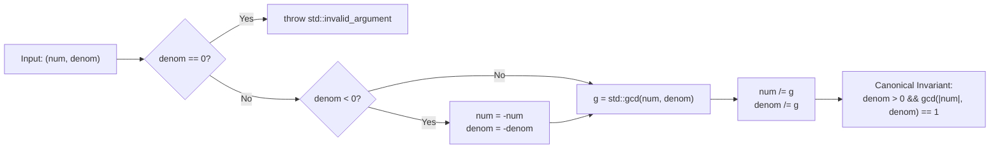

# RationalNumber — Generic Exact Fraction Arithmetic in C++


A header-only generic C++ class template (`RationalNumber<T>`) for exact rational (fraction) arithmetic, developed as part of a university **Data Structures** course. Parameterized over any underlying integer type `T` (such as `int`, `long long`, or `unsigned long long`), `RationalNumber<T>` eliminates IEEE-754 floating-point representation error by maintaining fractions in canonical reduced form $\frac{p}{q}$ with $q > 0$ and $\gcd(|p|, q) = 1$.

---

## Table of Contents

- [Overview](#overview)
- [Key Technical Features](#key-technical-features)
- [Mathematical Invariants & Overflow Mitigation](#mathematical-invariants--overflow-mitigation)
- [Project Structure](#project-structure)
- [API Reference & Complexity](#api-reference--complexity)
- [Code Examples](#code-examples)
- [Test Suite (TDD)](#test-suite-tdd)
- [Building & Running](#building--running)
- [Design Trade-Offs: Rational vs. Floating-Point](#design-trade-offs-rational-vs-floating-point)
- [Author](#author)

---

## Overview

Floating-point types (`float`, `double`) cannot represent simple base-10 or base-3 fractions such as $\frac{1}{3}$ or $\frac{1}{10}$ exactly in binary. `RationalNumber<T>` solves this by storing a numerator (`_num`) and denominator (`_denom`) of integral type `T` and overloading C++ arithmetic, relational, stream, cast, and literal operators so that fractions behave like built-in numeric primitives.

The implementation resides in [`RationalNumber/RationalNumber.h`](RationalNumber/RationalNumber.h) inside `namespace yourname` (with user-defined literals in `namespace yourname::literals`) and is verified by **9 automated test suites** in [`RationalNumber/Tests/`](RationalNumber/Tests/).

---

## Key Technical Features

- **Automatic Canonicalization (Irreducible Form)**
  - Every constructed or mutated `RationalNumber<T>` is automatically reduced via `std::gcd` from `<numeric>` so that $\gcd(\text{\_num}, \text{\_denom}) = 1$.
  - Sign normalization guarantees `_denom > 0` at all times; negative signs are always stored in `_num`.
- **Overflow-Aware Arithmetic**
  - **Addition & Subtraction (`+=`, `-=`)**: Uses `std::lcm(this->_denom, other._denom)` and divides each denominator *before* multiplying into the numerator:
    ```cpp
    T temp = std::lcm(this->_denom, other._denom);
    this->_num = this->_num * (temp / this->_denom) + other._num * (temp / other._denom);
    this->_denom = temp;
    ```
  - **Multiplication & Division (`*=`, `/=`)**: Cross-reduces `(this->_num, other._denom)` and `(this->_denom, other._num)` via `reduce()` *prior* to multiplication, preventing intermediate integer overflow on large 64-bit operands.
- **Complete Operator Overloading**
  - Compound assignment: `+=`, `-=`, `*=`, `/=`
  - Binary arithmetic: `+`, `-`, `*`, `/` (including mixed `T` + `RationalNumber<T>` overloads)
  - Unary sign operators (`+r`, `-r`) and prefix/postfix increment & decrement (`++r`, `r++`, `--r`, `r--`)
  - Six relational operators: `==`, `!=`, `<`, `<=`, `>`, `>=`
  - Implicit/explicit type conversions: `operator int()`, `operator float()`, `operator double()`, `operator bool()`
  - Stream insertion: `operator<<` outputs `"num/denom"`
- **User-Defined Literal (`_r`)**
  - Provided in `namespace yourname::literals`, allowing expressive fraction syntax such as `auto x = 7_r / 8_r;`.

---

## Mathematical Invariants & Overflow Mitigation



Because canonicalization is enforced as a class invariant:
- **Equality (`operator==`)** runs in $O(1)$ time by directly comparing `lhs._num == rhs._num && lhs._denom == rhs._denom` without needing extra reductions.
- **Cross-Canceled Multiplication (`operator*=`)** can multiply fractions with numerators/denominators near $2^{61}$ (such as $\frac{2305843009213693951}{1000010197} \times \frac{2000020394}{2305843009213693951} = \frac{2}{1}$ in `Test7.h`) without overflowing `unsigned long long`.

---

## Project Structure

```text
RationalNumber/
├── RationalNumber.sln                              # Visual Studio 2022 Solution
├── .gitignore                                      # Visual Studio & build artifact ignores
├── README.md                                       # Project documentation
│
└── RationalNumber/
    ├── RationalNumber.h                            # RationalNumber<T> class template & operators
    ├── main.cpp                                    # Test runner entry point
    ├── RationalNumber.vcxproj                      # MSVC project configuration (v143)
    ├── RationalNumber.vcxproj.filters              # Solution Explorer filters
    │
    └── Tests/                                      # 9 Incremental TDD Test Suites
        ├── Test0.h                                 # Console sanity check for +=, -=, *=, /=, ++
        ├── Test1.h                                 # Lexical verification of compound assignments & ++
        ├── Test2.h                                 # Binary +, -, *, / operators
        ├── Test3.h                                 # Mixed scalar-fraction arithmetic (1 + r, 3 * r) & unary +/-
        ├── Test4.h                                 # Type cast operators (double, float, int)
        ├── Test5.h                                 # GCD reduction & negative sign normalization
        ├── Test6.h                                 # Relational operators (<, >, <=, >=, ==, !=)
        ├── Test7.h                                 # Large-integer & 64-bit overflow-resistant arithmetic
        ├── Test8.h                                 # User-defined literal (_r) in yourname::literals
        └── Utils/
            ├── CustomAsserts.h                     # Assertion utilities (assertLexicallyEqual, assertFloatEqual, etc.)
            └── CustomAsserts.cpp                   # Boolean assertion implementation (assertBool)
```

---

## API Reference & Complexity

Let $M = \min(|a|, |b|)$ denote the magnitude of operands passed to Euclidean `std::gcd` / `std::lcm`.

| Category | Signature | Complexity | Description |
| :--- | :--- | :---: | :--- |
| **Constructor** | `RationalNumber(T num = 0, T denom = 1)` | $O(\log M)$ | Initializes $\frac{\text{num}}{\text{denom}}$, normalizes sign, and reduces via `std::gcd`. Throws `std::invalid_argument` if `denom == 0`. |
| **Compound Add/Sub** | `RationalNumber& operator+=(const RationalNumber& other)`<br>`RationalNumber& operator-=(const RationalNumber& other)` | $O(\log M)$ | Adds or subtracts `other` in-place using `std::lcm`. |
| **Compound Mul/Div** | `RationalNumber& operator*=(const RationalNumber& other)`<br>`RationalNumber& operator/=(const RationalNumber& other)` | $O(\log M)$ | Cross-reduces operands via `std::gcd` and multiplies in-place. `/=` throws `std::logic_error` if `other == 0`. |
| **Inc / Dec** | `operator++()`, `operator++(int)`<br>`operator--()`, `operator--(int)` | $O(1)$ | Increments or decrements `_num` by `_denom`. |
| **Unary Sign** | `RationalNumber operator+() const`<br>`RationalNumber operator-() const` | $O(1)$ | Returns copy or negated copy (`-_num / _denom`). |
| **Binary Arithmetic** | `operator+`, `operator-`, `operator*`, `operator/` | $O(\log M)$ | Supports `(RationalNumber, RationalNumber)` and `(T, RationalNumber)`. |
| **Type Casts** | `operator int() const`, `operator float() const`,<br>`operator double() const`, `operator bool() const` | $O(1)$ | Converts fraction to target built-in scalar type (`bool` checks `_num != 0`). |
| **Equality** | `operator==`, `operator!=` | $O(1)$ | Compares canonical `_num` and `_denom` directly. |
| **Ordering** | `operator<`, `operator<=`, `operator>`, `operator>=` | $O(1)$ | Compares via cross-multiplication `lhs._num * rhs._denom < rhs._num * lhs._denom`. |
| **Stream Output** | `operator<<(std::ostream& os, const RationalNumber<U>& r)` | $O(1)$ | Writes `"_num/_denom"` to `os`. |
| **Literal** | `RationalNumber<unsigned long long> operator""_r(unsigned long long)` | $O(1)$ | Constructs a `RationalNumber<unsigned long long>` from an integer literal. |

---

## Code Examples

### 1. Exact Fraction Arithmetic & Reduction

```cpp
#include "RationalNumber/RationalNumber.h"
#include <iostream>

int main()
{
    using yourname::RationalNumber;
    using namespace yourname::literals;

    RationalNumber<int> a(10, 120); // Automatically reduced to 1/12
    RationalNumber<int> b(9, -10);  // Normalized to -9/10

    RationalNumber<int> sum = a + b;
    std::cout << "a = " << a << ", b = " << b << "\n";       // a = 1/12, b = -9/10
    std::cout << "a + b = " << sum << "\n";                  // a + b = -49/60
    std::cout << "As double: " << static_cast<double>(sum) << "\n";

    // Using user-defined literals
    auto c = 7_r / 5_r + 2_r / 10_r;
    std::cout << "7/5 + 2/10 = " << c << "\n";               // 8/5
    return 0;
}
```

---

## Test Suite (TDD)

All 9 test suites in [`RationalNumber/Tests/`](RationalNumber/Tests/) execute automatically during static initialization before `main()`:

| # | Test File | Verified Behavior |
| :-: | :--- | :--- |
| **0** | [`Test0.h`](RationalNumber/Tests/Test0.h) | Basic console output trace of `+=`, `-=`, `*=`, `/=`, post-increment, and pre-increment. |
| **1** | [`Test1.h`](RationalNumber/Tests/Test1.h) | Automated lexical assertions (`assertLexicallyEqual`) for compound assignments and `++`. |
| **2** | [`Test2.h`](RationalNumber/Tests/Test2.h) | Binary `+`, `-`, `*`, and `/` operators producing new `RationalNumber` instances. |
| **3** | [`Test3.h`](RationalNumber/Tests/Test3.h) | Mixed scalar left-hand-side operations (`1 + r`, `3 * r`) and unary `+r` / `-r`. |
| **4** | [`Test4.h`](RationalNumber/Tests/Test4.h) | `static_cast<double>`, `static_cast<float>`, and `static_cast<int>` conversions. |
| **5** | [`Test5.h`](RationalNumber/Tests/Test5.h) | GCD reduction (`10/120 -> 1/12`) and sign normalization (`-7/-2 -> 7/2`, `9/-10 -> -9/10`). |
| **6** | [`Test6.h`](RationalNumber/Tests/Test6.h) | All 6 relational operators (`<`, `>`, `<=`, `>=`, `==`, `!=`) across positive and negative fractions. |
| **7** | [`Test7.h`](RationalNumber/Tests/Test7.h) | Large 32-bit and 64-bit (`unsigned long long`) fractions requiring pre-multiplication GCD cancellation. |
| **8** | [`Test8.h`](RationalNumber/Tests/Test8.h) | User-defined literal `10_r`, `7_r / 8_r`, and arithmetic expressions with `_r`. |

---

## Building & Running

### Option 1: Visual Studio 2022

1. Open `RationalNumber.sln` in **Visual Studio 2022**.
2. Select **Debug / x64** or **Release / x64**.
3. Build (`Ctrl + Shift + B`) and run (`Ctrl + F5`).

### Option 2: Command-Line Compilation (MSVC / GCC / Clang)

**MSVC:**
```powershell
cl /EHsc /std:c++20 /W3 RationalNumber\main.cpp RationalNumber\Tests\Utils\CustomAsserts.cpp /Fe:rational_tests.exe
.\rational_tests.exe
```

**GCC / Clang:**
```bash
g++ -std=c++20 -Wall -Wextra RationalNumber/main.cpp RationalNumber/Tests/Utils/CustomAsserts.cpp -o rational_tests
./rational_tests
```

**Expected Output:**
```text
19/3
4/3
20/3
4/3
0/1
2/1
All tests passed!
```

---

## Design Trade-Offs: Rational vs. Floating-Point

As prompted in the coursework specification in [`RationalNumber.h`](RationalNumber/RationalNumber.h):
- **Advantages of `RationalNumber<T>`**:
  - Exact representation of all rational quantities without rounding drift (critical in symbolic algebra, financial ledgers, and exact computational geometry).
- **Downsides & Potential Improvements**:
  - **Denominator Growth**: Repeated additions of fractions with coprime denominators cause `_denom` (via `std::lcm`) to grow rapidly toward `std::numeric_limits<T>::max()`, eventually risking integer overflow unless paired with an arbitrary-precision `BigInt` type.
  - **Runtime Overhead**: Every arithmetic operation invokes Euclidean `std::gcd` / `std::lcm` ($O(\log(\min(a,b)))$) instead of a single hardware FPU instruction.
  - **Irrational Numbers**: Cannot exactly represent irrational values ($\sqrt{2}, \pi, e$) or transcendental functions ($\sin, \cos, \log$).
  - **Future Extensions**: Adding `RationalNumber(const RationalNumber&, const T&)` right-hand scalar overloads (`r + 1`), calling `reduce(_num, _denom)` at the end of `operator+=` / `operator-=`, and using `explicit operator bool() const` to prevent unintended implicit integer conversions.

---

## Author

- **Davit Bakhshyan** — [@DavitBakh](https://github.com/DavitBakh)
